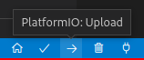
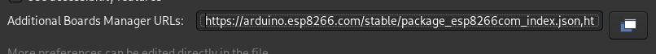
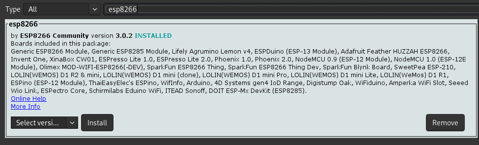
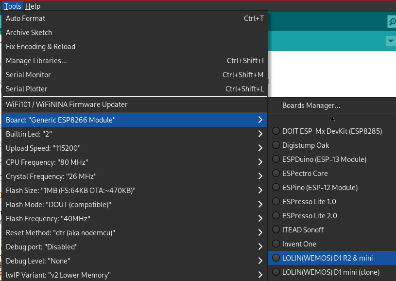
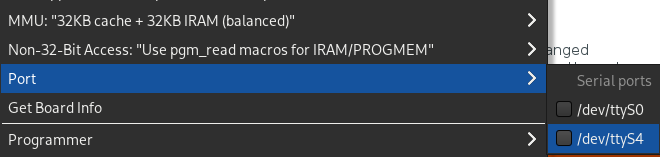
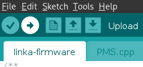

# linka-firmware

ESP8266 firmware for [AireLibre](https://github.com/melizeche/AireLibre)

## I want to flash my board with the latest firmware

Go to [linka.servin.dev](https://linka.servin.dev) and follow the instructions

## I want to build from sources

You can use [ PlatformIO ](https://platformio.org/platformio-ide) or [ Arduino IDE ](https://www.arduino.cc/en/software) to upload the firmware

### PlatformIO (recommended)

Install [ PlatformIO ](https://platformio.org/platformio-ide) and...

#### ... in Visual Studio Code

- Open the project with vscode having the platformio plugin installed
- Click on the right arrow icon on the platformio toolbar



#### ... or in your terminal

```bash
platformio run -t upload
````

#### ... if you want to upload via OTA, add the following lines to the `platformio.ini`

and the code will compile and upload to your connected device (it should be detected automatically)

```bash
upload_protocol = espota
upload_port = <IP_ADDRESS_OF_YOUR_SENSOR>
````

and upload just like the previous method. Your computer must be on the sensor's network.

If the sensor has a "Password for uploads over the local network" (in its setup page, or
`ota_password` over USB), add it too:

```bash
upload_flags = --auth=<PASSWORD>
````

Without a password, anyone on the sensor's network can upload firmware to it. A new
password applies when the sensor restarts.

### Arduino IDE

Install [ Arduino IDE ](https://www.arduino.cc/en/software) and...

- Open **File -> Preferences** and copy the following urls on the __"Additional Boards Manager URLs"__ input text

```
https://arduino.esp8266.com/stable/package_esp8266com_index.json,https://dl.espressif.com/dl/package_esp32_index.json
```



and click on **Ok**

- Install the esp8266 boards family on **Tools -> Boards Manager**



- Select the corresponding esp8266 board on **Tools -> Board:** for example the **"LOLIN(WEMOS) D1 R2 & mini"** 



- Install these libraries by clicking on the **Tools -> Manage Libraries...**

  * WifiConnect Lite
  * PubSubClient (by Nick O'Leary)
  * ArduinoJson (important! select a version previous to 6.0.0, 5.13.5 i.e.)

- Select the correct port on the **Tools -> Port:** menu



- Upload the sketch using the arrow button or by selecting the **Sketch -> Upload** menu



## Enjoy!


## Setting up a sensor over USB
After installing the firmware, the [web flasher](https://linka.servin.dev) can send the
sensor's settings (Wi-Fi network, API key, location, ...) over the same USB cable, so
it starts measuring without going through its Wi-Fi setup portal. It can also change
the settings of a sensor that already runs this firmware.

At boot, the sensor prints `LINKA_READY {"version":...,"device":...}` on the serial
port (115200 baud) and listens for 2 seconds for a line like:
```
LINKA_CONFIG {"wifi_ssid":"...","wifi_password":"...","api_key":"...","latitude":"-25.28","longitude":"-57.63"}
```
Every setting is optional: only the ones sent change (`wifi_ssid`, `wifi_password`,
`api_key`, `latitude`, `longitude`, `sensor`, `description`, `api_url`, `ota_server`,
`ota_password`).
It answers `LINKA_CONFIG_OK` or `LINKA_CONFIG_ERROR <reason>`, and then
`LINKA_WIFI_CONNECTED <ip>` or `LINKA_WIFI_FAILED` (and opens the setup portal, as
before). See [`serial_config.h`](serial_config.h).

Run the parsing tests on your computer (after a `pio run`) with
`tools/test_serial_config.sh`.

## Releasing
The git tag is the version: there is no version to bump in the code. `version.py` sets
`VERSION` at build time (development builds report e.g. `0.3.2-4-gabc1234`).

To release the current `master`:
```
gh release list --limit 1        # latest release
gh release create vX.Y.Z --target master --generate-notes
```
Add `--prerelease` (or use a tag like `v1.0.0-rc.1`) for a pre-release. Pushing a tag
with git (`git tag vX.Y.Z && git push origin vX.Y.Z`) works too.

Releases must be on `master`, but pre-releases may come from any branch, e.g. to try a
pull request on devel sensors before merging it:
```
gh release create vX.Y.Z-rc.N --target <branch> --generate-notes --prerelease
```
The version needs a pre-release suffix (`-rc.N`) and the release must be marked as a
pre-release, so it only goes to the devel track. Use a new rc number for each build.

CI builds the firmware, publishes a GitHub release with `linka-firmware-vX.Y.Z.bin`, and
deploys it to the [OTA server](https://github.com/garyservin/linka-ota-server):

- Releases go to the **production** track, offered to every sensor using the default
  OTA URL `https://linka.servin.dev/ota`.
- Pre-releases go to the **devel** track, offered only to sensors whose "Server for OTA
  upgrades" (in the setup page) is `https://linka.servin.dev/ota/devel`. Devel sensors
  also get production releases newer than the devel version.

## Testing on a device
`tools/ota-test.sh` runs a local copy of the [OTA server](https://github.com/garyservin/linka-ota-server)
(next to this repo) so a test sensor can be updated over the air without touching production.
It also accepts the sensor's reports on `/api`, and checks and prints each one (API key redacted)
instead of sending them to AireLibre:
```
tools/ota-test.sh setup          # test dir with a certificate and the latest release
tools/ota-test.sh serve          # prints the URLs to set in the sensor's setup page
tools/ota-test.sh add            # build this checkout and serve it as latest
tools/ota-test.sh latest 0.3.2   # roll back
```
Run `tools/ota-test.sh help` for all commands.
